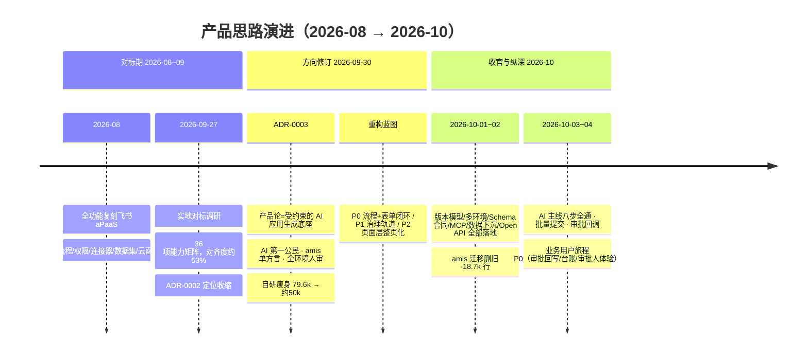
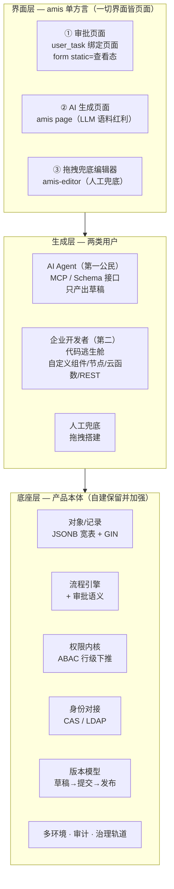
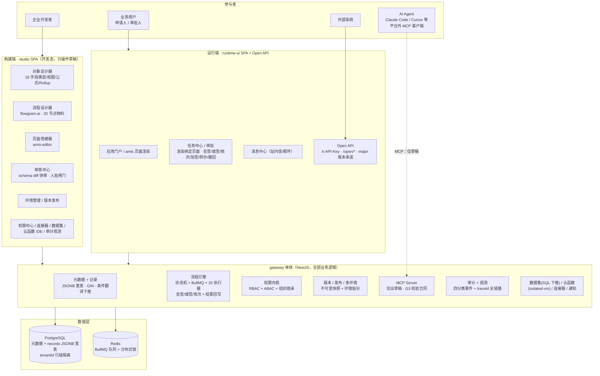
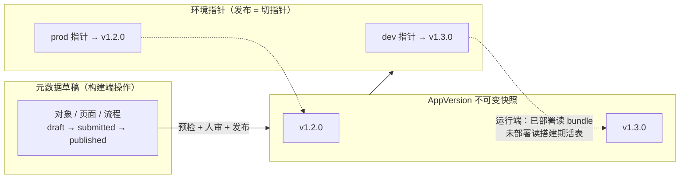
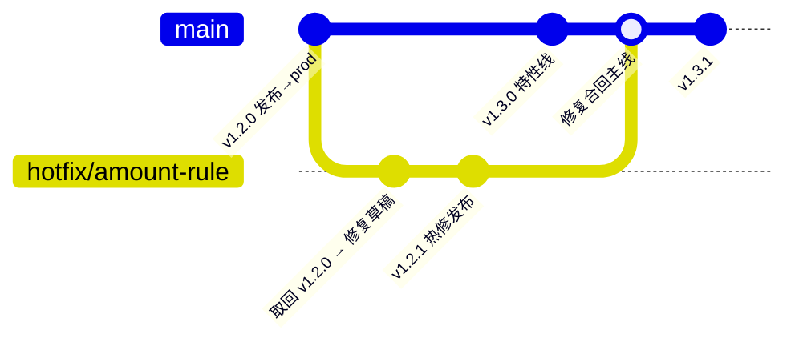
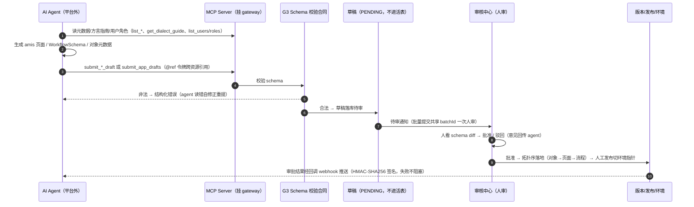
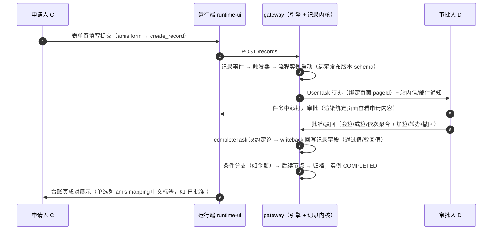
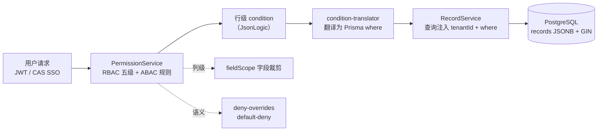

# aPaaS 平台 — 产品思路与架构总览

- 汇总日期：2026-10-05
- 性质：产品思路 + 架构设计的单篇汇总（带图速览版），供快速理解全貌使用
- 权威来源（冲突时以其为准）：
  - 方向决策：`docs/adr/0002-platform-positioning-enterprise-non-feishu.md`、`docs/adr/0003-ai-native-schema-first-platform.md`
  - 技术架构全文：`docs/architecture/ARCHITECTURE.md`
  - 阶段蓝图：`docs/design/DESIGN-refactor-blueprint-2026-09-30.md`
  - 路线图：`docs/roadmap/ROADMAP.md`（2026-09-30 方向修订节）

---

## 1. 一页速览

**这是什么**：面向**企业内部真实使用**的低代码/aPaaS 平台，产品论 = **受约束的 AI 应用生成底座**。

**一句话**：AI Agent 经 MCP/Schema 接口生成应用元数据（只出草稿），人通过审核中心 schema diff 快审把关后发布，业务用户在运行端使用"表单 + 审批 + 报表"类应用——**元数据与治理轨道是产品本体，AI 是第一公民用户，界面层统一 amis 单方言**。

| 关键事实（2026-10-05 快照） | 数值 |
|---|---|
| 自研代码规模 | ~61.5k 行（R1.7 删旧后；目标 ~50k） |
| 页面层方言 | 唯一 amis（唯一搭建器 amis-editor / 唯一渲染器 / 唯一 G3 校验） |
| 单元测试 | gateway 722 / studio 119 / db 55 / shared 17，全绿 |
| e2e | 88/88（2026-10-02 快照，Playwright） |
| 首个验收应用 | 采购合同类流程审批（全链路 e2e 走通） |
| AI 生成完整应用成本 | 2 次 MCP 调用 + 1 次人审（资源依赖链批量提交） |
| 技术栈 | pnpm monorepo + Turborepo · React+Vite+AntD+amis+flowgram.ai · NestJS+Prisma · PostgreSQL+Redis+BullMQ |

---

## 2. 产品思路演进

平台方向经历三次收敛，每次都有 ADR 背书：



### 2.1 起点：全功能对标飞书（2026-08）

以飞书 aPaaS 完整功能体系为目标，按 Phase 0-10 依次建成对象建模、可视化页面搭建器、自研流程引擎、权限多租户、连接器、数据集、仪表盘、云函数、应用管理发布。

### 2.2 定位收缩（ADR-0002，2026-09-27）

36 项能力实测对齐度仅 ~53%，全面补齐远超承载 → 四项定位答案：

1. **企业内部真实使用**——首要成功标准从"对齐度数字"改为"能完整交付并运行一个真实业务应用（表单+审批+报表）"；
2. **目标环境为非飞书的企业环境**——组织与身份经可插拔对接层接入（确认 CAS SSO + LDAP/人力主数据）；
3. **使用者先开发者后业务**；
4. 飞书只作**能力形态参考**（版本模型/权限语义/流程节点语义/观测分类/编辑器信息架构），飞书生态特有项（连接器市场、飞书审批/事件、行业模板市场）移出对标范围。

新 P0 五项：身份与组织对接层、草稿→提交版本模型、流程表单与审批语义、多环境化、端到端真实应用交付。

### 2.3 AI 原生（ADR-0003，2026-09-30）— 当前有效

结构性根因诊断：~37k 行投在搭建器 UI，86 组件渲染矩阵没有显式"属性合同"（属性面板写入的字段名 ≠ 渲染器读取的字段名，一次实测爆发 9 个同口径 bug），而真正决定平台价值的元数据/治理层反而最薄 → **产品重心放错层**。叠加行业信号（NocoBase 转向 "AI + no-code"，渲染器/引擎类 OSS 集体进入静默期），做出五个决策：

1. **产品论**：平台 = 受约束的 AI 应用生成底座。AI Agent 为第一公民用户（经 MCP/Schema 接口，**仅出草稿**），企业开发者第二（代码逃生舱），拖拽搭建降级为人工兜底；
2. **治理闸门 = 全环境人审**：AI 产出必须过审核中心 diff 快审，任何环境发布无例外；
3. **界面层 = amis 单方言**：撤销自研 86 组件矩阵，form 是 page 体系内的组件类型，**不设"页面/表单"两套概念，不引入 formily**；
4. **自研瘦身**：渲染矩阵/数据集引擎/双渲染器换开源或下沉，流程引擎、权限内核、对象模型、身份层保留并加强；
5. **首个验收应用锁定采购合同类流程审批**——重构与首个真实应用交付合二为一。

### 2.4 演进中不变的东西

- 自研流程引擎与审批语义**不外接审批中心**（ADR-0002 决策 5）；
- 零兼容原则（未上线即零历史包袱，果断删旧，见知识库 Zero-Compat）；
- 类型契约先行（shared SSOT）、文档/测试与功能同轨交付的工程纪律。

---

## 3. 核心产品原则（不变量）

| # | 原则 | 内容 | 出处 |
|---|---|---|---|
| 1 | **双端分离** | 构建端（studio）永远操作草稿态；运行端只读已发布快照（AppVersion bundle + 环境指针）；未部署应用在搭建期读活表（dev 模式） | 架构铁律 |
| 2 | **AI 只出草稿，人审是唯一发布闸门** | 全环境无例外；审核中心 schema diff 快审是验收项 | ADR-0003 |
| 3 | **一切界面皆页面** | 审批节点绑定的是页面（纯表单页或表单+关联信息页）；同一搭建器、同一校验器、随应用快照统一版本 | ADR-0003 |
| 4 | **Schema 优先 / 元数据驱动** | 页面=amis 方言、流程=WorkflowSchema、数据=对象元数据；三类元数据皆 JSON Schema 校验合同（G3），非法即拒 | ADR-0003 |
| 5 | **WorkflowSchema SSOT** | 流程引擎直接消费 JSON Schema，编辑器（flowgram 单模式）零翻译 | ADR-0001 |
| 6 | **单体优先** | 三个微服务骨架保留但不拆分，全部业务在 gateway | ADR-0001 (TD-16) |
| 7 | **JSONB 宽表** | 记录存储用通用 records 表 + data JSONB + GIN 索引，非每对象建表 | ADR-0001 |
| 8 | **行级权限走条件翻译** | PermissionService 算 condition → translator 翻译为 Prisma where → RecordService 注入查询 | ADR-0001 |
| 9 | **事件驱动，禁定时器轮询** | 状态同步一律事件 API / Pub-Sub / 队列；ESLint 拦截 setInterval | 工程红线 |
| 10 | **多租户全域行隔离** | tenantId 三层：手动 → Prisma $extends 自动注入（ALS）→ RLS（未来） | 架构 |

---

## 4. 参与者与应用形态

### 4.1 四类参与者

| 参与者 | 入口 | 权限语义 |
|---|---|---|
| **AI Agent**（第一公民） | 平台外 MCP 客户端（Claude Code / Cursor 等），推理不落平台 | 服务身份（API Key）；只能产出草稿；操作全量审计；AI 生成的应用跑在同一权限内核 |
| **企业开发者**（第二） | studio SPA | 人工提交即时 APPROVED 基线；代码逃生舱（自定义组件/节点/云函数/REST API） |
| **业务用户**（申请人 C / 审批人 D） | runtime-ui SPA | 行级 ABAC 可见性；任务中心审批 |
| **外部系统** | Open API（/open/*） | X-API-Key 服务身份；major 版本稳定性承诺 |

### 4.2 应用三形态

```text
① 纯页面        表单收集 + 台账/报表展示
② 流程 + 页面   ★ 验收形态（采购合同审批）：表单提交 → 条件分支 → 多级审批 → 状态回写 → 台账
③ 纯流程 headless  API 触发器 + API Key + 流程版本稳定性承诺（外部系统对接）
```

---

## 5. 目标态三层架构



> 层间为"依赖/承载"关系：界面层是底座元数据的一种消费形态；生成层的一切写入都受底座治理轨道约束。

---

## 6. 技术架构

### 6.1 全局拓扑



**部署形态**：nginx（TLS + 双前端静态产物）→ gateway ×N → PostgreSQL + Redis；附件当前本地卷（生产建议对象存储，待立项）。

### 6.2 工程结构（pnpm monorepo + Turborepo）

```text
apps/gateway/          NestJS API 网关 —— 所有后端业务逻辑集中于此（单体优先）
packages/shared/       跨层类型契约 SSOT（Branded types / DTO / 观测分类）
packages/db/           Prisma schema + 迁移 + 种子数据
packages/studio/       搭建器前端（React + Vite + AntD + amis-editor + flowgram.ai）
packages/runtime-ui/   运行时前端（React + Vite + AntD + AmisRenderer）
packages/meta-svc/     微服务骨架（仅 health check，业务在 gateway）
packages/process-svc/  同上
packages/runtime-svc/  同上
infra/                 Docker Compose + Nginx + 启动脚本
docs/                  PRD / DESIGN / ADR / RESEARCH / ROADMAP / knowledge-base
```

### 6.3 技术栈选型及理由

| 层 | 选型 | 理由 |
|---|---|---|
| 界面方言 | **amis**（6.x，Apache-2.0） | 成熟渲染合同从土壤上消除"属性合同"类缺陷；LLM 语料红利；fork 预案可行。明确不引入 formily（停更 + 场景不匹配） |
| 流程编辑器 | **flowgram.ai** | 单模式画布，extInfo 经 EventBridge 并入导出，WorkflowSchema 零翻译 |
| 后端 | NestJS + Prisma + PostgreSQL | JSONB 宽表 + GIN + `$extends` 租户自动注入 |
| 异步 | BullMQ + Redis | 流程/延迟/数据集/webhook 队列 + 分布式锁 |
| 云函数 | isolated-vm | 沙箱隔离 + 并发预算 |
| 质量 | Vitest（单测）+ Playwright（e2e）+ G3 三校验器 | 覆盖率阈值强制；非法元数据合同层拒收 |

---

## 7. 关键机制与数据流

### 7.1 版本模型与多环境

**资源级三态**（对象/页面/流程统一）：`draft → submitted → published`；**应用级**：AppVersion 不可变快照 + 环境指针（dev/prod）。发布双闸 = 预检 + 人审。



**版本谱系**——hotfix 线与特性线并行，线上修复不携带半成品特性；对外 API 绑定 major 版本（v2 发布不破坏 v1 调用方）：



运行态不变量：① 运行端看不到未发布变更；② 快照不可变，修复只产生新版本；③ 流程实例绑定发布版本执行。

### 7.2 AI 生成与治理链路（平台外生成，平台内审核）



MCP 工具面：`get_platform_overview` / `create_application` / `list_objects|pages|processes` / `get_page|process` / `get_dialect_guide`（三类方言指南）/ `validate_schema`（dry-run）/ `submit_object|page|workflow_draft` / `submit_app_drafts`（单波批量）/ `list_review_submissions` / `list_users|roles`。

**规范传导四层机制**（外部工具"提交时强制服从"，不依赖模型恰好训练过方言）：

1. 校验反馈闭环——校验器即编译器，报错即教学，合法率随回合收敛（最硬一道）；
2. 工具参数即合同——MCP 工具自带参数 JSON Schema；
3. 方言指南作为 MCP Resources 下发；
4. 服务端 few-shot 与现存合法 schema 只读示例。

### 7.3 业务用户运行时闭环（申请人 C / 审批人 D）



回写走 RecordService 写内核（触发记录事件，可再级联流程）；非记录触发跳过、失败留痕不阻断主流程。

### 7.4 权限：RBAC + ABAC 行级下推



- 资源五级：页面 / 记录 / 流程 / 数据模型 / 连接器；组织树授权上级自动继承全部后代（BFS 扩散防环）；
- **AI 无特权路径**：AI 生成的应用跑在同一权限内核；"审核/批准"本身是权限点；AI 产出的草稿带服务身份与 diff，人批后以发布人身份入版本历史；
- 配套调试工具：`PermissionService.explain` + 权限调试页（"谁能看到这条记录"反向验证）。

### 7.5 数据层与多租户

- **PostgreSQL**：元数据表族 + `records` JSONB 宽表（`data` GIN、等值过滤 `@>`、按类型 cast 排序）+ 版本/环境/审计表；新增模型铁律：`tenantId` + `@@index([tenantId])` + Tenant 关系 + 级联删除 + JSON `@default("{}")`；
- **租户隔离三层**：L1 手动 tenantId / L2 Prisma `$extends` 自动注入（11 操作 × 24 模型，ALS 上下文，BullMQ worker 恢复）/ L3 RLS（未来）；
- **数据集已全量下推 SQL**（G5）：聚合/物化为 PostgreSQL 子查询 + GROUP BY（regex 守卫），非聚合 filter 内存兜底、聚合不可下推显式报错——消灭内存 join 卡死类 bug；
- **Redis**：BullMQ 队列 + 分布式锁（多副本压测为遗留风险项）。

---

## 8. AI 可控性设计（本次产品论的成立前提）

AI 可控 = 三层机制，缺一层就不可信：

| 层 | 机制 | 状态 |
|---|---|---|
| **Schema 合同层** | G3 三类 JSON Schema 校验器（amis / WorkflowSchema / 对象元数据），非法即拒 + 结构化错误返 agent 自修正 | ✅ |
| **治理轨道层** | G1 版本模型：AI 仅草稿 → diff 快审 → 人批才落地；漂移保护；批量审计 | ✅ |
| **运行时权限层** | ABAC 条件下推 + 租户隔离 + 全量审计（AI 生成的应用跑在同一内核） | ✅（既有自研资产） |

配套：审批结果回调 webhook（`REVIEW_CALLBACK_URL`，替代轮询）+ 观测四分类（FUNCTION_EXEC / SLOW_QUERY / PAGE_ERROR / OPEN_API_CALL）+ traceId 全链路。

**生成位置的分界线**：AI 推理与 agent 循环在平台外（Claude Code/Cursor，先开发者后业务）；**审核与发布永远在平台内**。自建对话式 agent 界面明确不做（未来若做，也只是又一个 MCP 客户端）。

---

## 9. 自研边界

### 9.1 瘦身清单（79.6k → 61.5k，目标 ~50k）

| 处置对象 | 规模 | 去向 | 状态 |
|---|---|---|---|
| 86 组件渲染矩阵 + 双渲染器 | ~12k | 换 amis 渲染器 | ✅ |
| v1 搭建器 + 渲染残骸 + 方言合同 | ~18.7k | 物理删除 | ✅ |
| 数据集内存 join 引擎 | ~2.5k | 下沉 PostgreSQL SQL | ✅ |
| **保留并加强**（差异化内核） | — | 流程引擎+审批语义 / 权限内核 / 对象模型 / 身份层 / 治理轨道 | 持续投入 |

### 9.2 明确不做

- **formily**（停更；审批表单场景用不上其深度字段联动；极端动态表单走 amis 自定义 React 组件逃生舱）
- **NocoBase 底座替换**（仅作架构参照 + Plan B；其付费墙功能恰为自研强项）
- **AI 无审核直接发布**（全环境人审为硬闸门）
- **自建对话式 agent 编排界面**（外部 IDE 级 agent 循环能力最强）
- **飞书生态特有项**（连接器市场、飞书审批/事件、行业模板市场）
- **独立移动端**（响应式基础即可）、定时器轮询类实现

---

## 10. 演进状态（截至 2026-10-05）

```text
P0 流程+表单闭环      ✅ S1 spike / S2 amis 渲染 / S3 R1.3 审批语义 / S4 采购合同应用 / S5 e2e 全绿
P1 治理轨道           ✅ G1 版本+审核中心 / G2 多环境 / G3 校验合同 / G4 MCP / G5 数据下沉 / G6 Open API
                      ✅ 观测事件四分类 + traceId + 流程效率分析 + 权限调试 + 审计分类（2026-10-02）
P2 页面层整页化       ✅ R1.7 三批次：v1 运行时下线 → amis-editor 画布 → v1 搭建器物理删除（-18.7k 行）
AI 第一公民主线       🔄 八步全通（建应用→草稿→人审→发布→触发→审批→回写→通知）
                      ✅ 批量提交（2 调用+1 人审）/ 审批回调 webhook / 必填守卫 / MCP 建应用
业务用户旅程 P0       ✅（2026-10-04）审批结果自动回写 + 表单/台账成对生成 + 审批人体验修复
双视角评审            ✅ 产品+技术双视角，8 项按钮级缺陷已修复
```

质量基线：gateway 722 / studio 119 / db 55 / shared 17 单测全绿；e2e 88/88；CI 四 job（static/test/build→e2e）+ 分支保护。

## 11. 风险与开放问题

| 风险/遗留 | 等级 | 处置 |
|---|---|---|
| amis 维护放缓（末 commit 2026-03） | 中 | 锁定版本 + fork 预案（Apache-2.0/ISC 无法律障碍） |
| 2 人审核吞吐（全环境人审） | 中 | diff 快审 UX 已交付；批量提交一次人审 |
| 多副本 Redis 锁未压测 | 中 | 水平扩展前补压测（已内置进程内降级） |
| 审批弹窗绑定表单页会允许审批人再提交 | 低 | 已知项，下轮改页面选择器过滤或只读渲染 |
| 附件本地卷 | 低 | 生产前迁对象存储（待立项） |
| LIKE/范围条件无法走 GIN | 低 | 大表压测后评估 |
