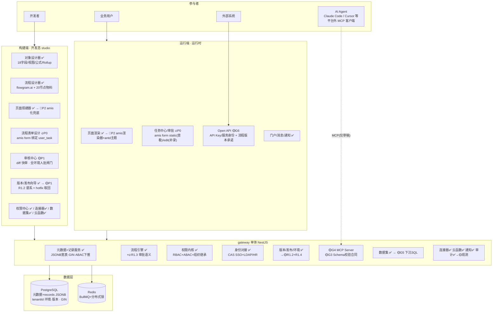
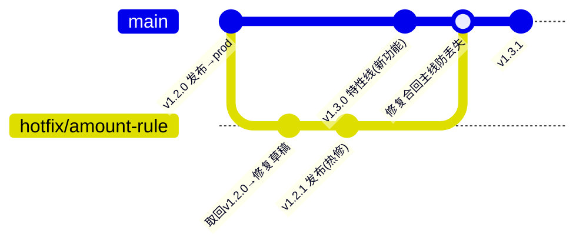

# aPaaS 平台架构总览（2026-09-30 全量修订）

> 本文是平台**全量**技术架构总览（构建态/运行态双端、租户、环境、版本管控、权限、AI 生成链路、部署拓扑），供所有开发 agent 参考。
> 2026-09-30 按 ADR-0003（AI 原生底座）全量重写；原版为 Phase 9 时期的分层速览。
> 方向决策：`docs/adr/0003-ai-native-schema-first-platform.md`；阶段任务：`docs/design/DESIGN-refactor-blueprint-2026-09-30.md`。

## 优先级图例（全文通用）

| 标记 | 含义 |
|---|---|
| ✅ | 既有已完成，保留并继续维护（不动大架构） |
| 🔥 | **P0** 当前最优先（蓝图 S 编号：spike / amis 表单通道 / R1.3 审批语义 / 采购合同验收应用） |
| 🟡 | **P1** 治理轨道（蓝图 G 编号：R1.2 版本谱系 / R1.4 多环境 / G3 校验合同 / G4 MCP / G5 数据下沉 / G6 API 产品化 / 观测分类） |
| 🔵 | **P2** 页面层整页化（蓝图 W 编号：R1.7 amis page / 组件 86→30 / 搭建器兜底改造 / v1 迁移） |
| 🔧 | 生产加固项（不改变功能，上线前必须补齐） |
| ⚪ | 有意暂缓（ADR-0003 明确不做或推迟） |

## 1. 一页总览

```
参与者         构建端（开发态 · studio SPA）                 运行端（运行时 · runtime-ui SPA / API 面）
──────   ┌─────────────────────────────────┐      ┌──────────────────────────────────┐
开发者 ──▶│ 对象设计器✅   流程设计器✅(flowgram)  │      │ 应用门户/页面渲染 ✅ →🔵P2 amis渲染  │
         │ 页面搭建器✅ →🔵P2 amis化(兜底)      │      │ 任务中心/审批 🔥P0(amis form渲染)   │
AI Agent │ 流程表单设计 🔥P0  权限中心✅         │      │ 消息中心(站内信/邮件)✅             │
(平台外)  │ 审核中心 🟡P1(diff快审,人批闸门)     │      │ Open API 🟡P1(API Key+版本承诺)    │
  │      │ 版本/发布✅ →🟡P1(三级版本+hotfix谱系)│      └───────────────┬──────────────────┘
  │ MCP  │ 连接器✅ 数据集画布✅ 云函数IDE✅      │                      │
  ▼      └───────────────┬─────────────────┘                      │ REST
┌─────────────────────────▼──────────────────────────────────────────▼─────────────┐
│                         gateway 单体（NestJS，全部业务逻辑，TD-16）                  │
│  元数据/记录 ✅(JSONB宽表+GIN+条件翻译下推)   流程引擎 ✅(状态机+BullMQ+20执行器)        │
│      + 🔥P0 R1.3 审批语义(会签/或签/依次/加签/转办/撤回/流程表单/出入参)                 │
│  权限内核 ✅(RBAC+ABAC行级下推+组织继承)      身份对接 ✅(CAS SSO+LDAP/HR目录同步)      │
│  版本/发布/环境 ✅(不可变快照+回滚) →🟡P1(R1.2三级版本+hotfix谱系 / R1.4 environmentId) │
│  🟡G3 Schema校验合同(amis/WorkflowSchema/对象元数据)  🟡G4 MCP Server(仅出草稿)       │
│  数据集 ✅ →🟡G5下沉PostgreSQL   连接器✅   云函数✅(isolated-vm)   通知✅            │
│  审计 ✅ →🟡P1观测事件分类                                                          │
└────────────────┬─────────────────────────────┬───────────────────────────────────┘
                 ▼                             ▼
    PostgreSQL（元数据+records JSONB 宽表+版本+环境，          Redis（BullMQ 队列+分布式锁，
      tenantId 全域行隔离+$extends 自动注入+GIN）               worker 上下文恢复）
```

- **双端分离铁律**：构建端永远操作草稿态；运行端**永远只读已发布快照**（`publishedSnapshot` / 环境指针），未发布变更对运行端不可见。
- **AI 生成不在平台内**：AI Agent 是平台外的 MCP 客户端（Claude Code/Cursor 等），经 gateway 的 MCP Server 写入——只产出草稿，必须过平台内人审（见 §8）。

## 2. 全局拓扑（标注优先级）



## 3. 构建端（开发态）功能清单

使用者：开发者（主）+ AI（经 MCP，产出进审核中心）。所有编辑只作用于草稿态。

| 能力 | 现状 | 优先级 |
|---|---|---|
| 应用管理（创建/预置对象角色/发布向导/预检/版本历史/回滚） | ✅ Phase 9 | 🟡 R1.2 谱系扩展 |
| 对象设计器（18 字段类型/视图/公式/Rollup/Lookup/自动编号） | ✅ | ✅ 保留 |
| 流程设计器（flowgram 单模式，20 节点物料 + 配置面板） | ✅ | ✅ + 🔥 R1.3 新审批节点属性 |
| 页面/表单搭建器（dnd 画布+属性面板，86 组件） | ✅ | 🔵 P2 改造为 amis 兜底编辑器 |
| **流程表单设计（amis form 编辑/对象字段绑定/审批节点挂载）** | ⬜ | 🔥 P0 |
| **审核中心（AI/提交稿 diff 快审、按对象/流程/页面粒度、批/驳）** | ⬜ | 🟡 G1 验收项 |
| 权限中心（角色/规则 fieldScope/组织授权） | ✅ | ✅ + 🟡 权限查询调试工具 |
| 连接器管理 / 数据集画布 / 云函数 IDE / 通知模板 | ✅ | ✅ + 🟡 G5 数据集简化 |
| 平台管理（租户/用户/组织同步/审计日志） | ✅ | ✅ + 🟡 观测分类 |

## 4. 运行端（运行时）功能清单

使用者：业务用户 + 外部系统。**只读已发布快照 + 执行写操作 API**。

| 能力 | 现状 | 优先级 |
|---|---|---|
| 应用门户/导航/页面渲染（自有渲染器 86 组件） | ✅ | 🔵 P2 切 amis 渲染器（antd 主题） |
| **任务中心审批：流程表单渲染（amis static=查看 / edit=补录）、会签或签操作** | 部分（基础审批） | 🔥 P0 |
| 消息中心（站内信/邮件/webhook 通知） | ✅ | ✅ |
| Open API（外部系统触发流程/读写记录；API Key/服务身份） | 部分（webhook/http） | 🟡 G6 |
| 移动端适配 | ✅（响应式基础） | ⚪ 独立移动端暂缓 |

## 5. gateway 服务层模块 × 优先级总表

| 模块 | 职责 | 优先级 |
|---|---|---|
| auth / identity | JWT + CAS SSO + LDAP/HR 目录同步（JIT/离职禁用） | ✅ |
| tenant / org / user | 租户、组织树、用户 | ✅ |
| object / record | 对象元数据 + records JSONB 宽表（GIN、类型 cast 排序、公式/Rollup/AutoNumber） | ✅（GIN-LIKE 边界为遗留技术边界） |
| permission | RBAC 五级 + ABAC 条件下推 + 组织继承扩散 | ✅（🟡 补权限调试工具） |
| **process（引擎 + 执行器）** | 状态机 + BullMQ + Redis 锁 + 20 执行器；**R1.3：会签/或签/依次/加签/转办/撤回/流程表单/出入参** | ✅ + 🔥 |
| **form（流程表单 schema）** | amis form schema 存取/版本/绑定（新建或并入 page 模块，P0 立项定） | 🔥 |
| page | 页面 schema CRUD + savepoint | ✅（🔵 P2 方言切 amis） |
| application / version / environment | 发布快照/预检/回滚 → **R1.2 三级版本+谱系 / R1.4 environmentId 多环境** | ✅ + 🟡 |
| **schema-contract（校验合同）** | 三类 JSON Schema 校验器（amis 表单/页面、WorkflowSchema、对象元数据）；非法即拒 | 🟡 G3（先于 G4） |
| **mcp（AI 生成接口）** | 对象/流程/页面/表单读写 + 草稿提交；写路径过 G3 + G1 | 🟡 G4 |
| dataset / dataflow | 内存 join 引擎 → **下沉 PostgreSQL SQL** | ✅ → 🟡 G5 |
| connector | HTTP 出站/webhook 入站/OAuth2/凭证加密 | ✅（🔧 webhook 签名加固） |
| cloud-function | isolated-vm 沙箱/Monaco/流程节点 | ✅（🔧 并发预算） |
| notification | email/in_app/webhook + 模板 | ✅ |
| audit / observability | 操作审计 + 应用级审计 → **观测事件分类（函数/慢查询/页面报错/OpenAPI+链路 ID）** | ✅ + 🟡 |

## 6. 数据层与多租户

- **PostgreSQL**：元数据表（objects/fields/views/pages/processes/forms/connectors/...）+ `records` JSONB 宽表（`data` GIN 索引、等值过滤 `@>`、按类型 cast 排序）+ `app_versions`（不可变快照）+ 环境表（R1.4）+ `audit_logs`。新增模型规范：`tenantId` + `@@index([tenantId])` + Tenant 关系 + 级联删除 + JSON `@default("{}")`。
- **租户隔离三层**：Layer 1 手动 tenantId（保留）/ Layer 2 Prisma `$extends` 自动注入（11 操作 × 24 模型，ALS 上下文，BullMQ worker 恢复）/ Layer 3 PostgreSQL RLS（未来）。
- **Redis**：BullMQ 队列（process/delay/dataset/webhook）+ 分布式锁（多副本前提：锁与队列压测为遗留风险项）。
- **文件/附件**：当前本地卷（multer）；🔧 生产建议对象存储（待立项）。

## 7. 版本管控（生产级核心，R1.2 落地）

### 7.1 资源与应用双级版本

- **资源级**：对象/页面/流程/表单各自 `draft → submitted → published` 三态 + 历史版本链。
- **应用级**：`AppVersion` 不可变快照（已实现）+ **环境指针**（R1.4：dev/prod 按 `environmentId` 隔离，发布=切指针，触发器随版本启停）。
- **发布双闸**：预检（已实现）→ **人审闸门（P1：AI 出稿必经审核中心人批；全环境无例外）** → 发布生成 `vX.Y.Z` → 切环境指针。

### 7.2 版本谱系：特性线与热修线并行（R1.2 新增设计要点）



- **取回（fork）**：从运行环境当前版本"取回"→ 复制为修复草稿（记录 `parent_version_id` 谱系）→ 修复 → 发布为 patch 版本（`v1.2.1`），与新功能线（`v1.3.0`）**并行**，线上修复不携带半成品特性。
- **合流**：hotfix 发布后自动合并回主线草稿（防修复丢失）；冲突按资源级三态提示人工解决。
- **回滚**：环境指针回切历史版本（API 已有）；**API 契约承诺**（G6）：对外触发 API 绑定 major 版本，minor/patch 发布不破坏 v1 调用方。

### 7.3 运行态不变量

1. 运行端只读快照，永远看不到未发布变更；
2. 快照不可变——修复不篡改历史版本，只产生新版本；
3. 流程实例绑定发布版本执行，版本切换不影响在途实例语义（升级语义为 P1 设计点）。

## 8. 权限设计（生产级核心）

- **主体**：用户（CAS SSO 登录、LDAP/HR 目录同步、JIT 开通/离职禁用）、**AI 服务身份**（API Key，经 MCP 提交草稿，操作全量审计）、外部系统（API Key，Open API）。
- **资源五级**：页面 / 记录 / 流程 / 数据模型 / 连接器；RBAC（租户级+应用级角色）+ **ABAC**（行级 `condition` → JsonLogic → Prisma `where` 下推查询层；列级 `fieldScope`）；deny-overrides、default-deny、super-admin 短路。
- **组织维度**：组织树授权，上级自动继承全部后代（BFS 扩散，防环）。
- **AI 无特权路径**：AI 生成的应用跑在同一权限内核；审核中心"批准/驳回"本身是权限点（谁可审可配）；AI 产出的草稿带服务身份与 diff，人批后以发布人身份入版本历史。
- 🟡 P1 配套：权限查询调试工具（"谁能看到这条记录"反向查询）。

## 9. AI 生成链路（平台外生成，平台内审核）

```
外部 MCP 客户端（Claude Code/Cursor…）        平台内（gateway）
  agent 循环：读元数据→生成schema→提交草稿  ──MCP──▶  🟡G3 校验合同（非法→结构化错误返自修正）
                                              → 合法→草稿+待审
                                              → 🟡G1 审核中心 diff 快审 → 人批 → 发布
```

- 生成物为**四类元数据**（amis page / amis form / WorkflowSchema / 对象元数据），**不出码**；界面方言=amis（语料红利），流程/对象为自有方言（few-shot+校验器兜底）。
- 规范传导四层：校验反馈闭环 / 工具参数即合同 / 规范 Resources 下发 / 服务端 few-shot。详见蓝图 G3/G4 补充节。
- 准入门槛：R1.S 两项 spike（antd 主题贴合度 / LLM 生成 amis schema 合法率）。

## 10. 部署拓扑（生产级）

```
nginx(TLS/静态资源: studio+runtime-ui 构建产物)
  └─ gateway ×N（NestJS；多副本依赖 Redis 分布式锁——压测为遗留风险项）
       ├─ PostgreSQL（主数据；备份策略见 docs/DEPLOYMENT.md）
       ├─ Redis（BullMQ+锁）
       └─ 附件存储（本地卷 → 🔧对象存储建议）
```

🔧 **生产加固清单**（上线前必须核对）：webhook 签名与防重放、云函数 Isolate 并发预算、附件对象存储、备份/恢复演练、Swagger 生产关闭（已做）、限流（已做）、登录防爆破（已做）、出站 SSRF 防护（已做）、结构化日志+观测事件分类（🟡）。

## 11. 阶段映射（与蓝图编号一一对应）

| 阶段 | 蓝图编号 | 对应本文模块 |
|---|---|---|
| P0 | S1 spike / S2 amis 表单通道 / S3 R1.3 审批语义 / S4 采购合同应用 / S5 e2e | §3 流程表单设计、§4 任务中心、§5 process/form 模块 |
| P1 | G1 版本+审核中心 / G2 多环境 / G3 校验合同 / G4 MCP / G5 数据下沉 / G6 Open API | §7 版本管控、§8 权限 AI 主体、§5 🟡 项 |
| P2 | W1-W4 amis page/组件裁剪/搭建器改造/v1 迁移 | §3 搭建器、§4 页面渲染、§5 page 模块 |
